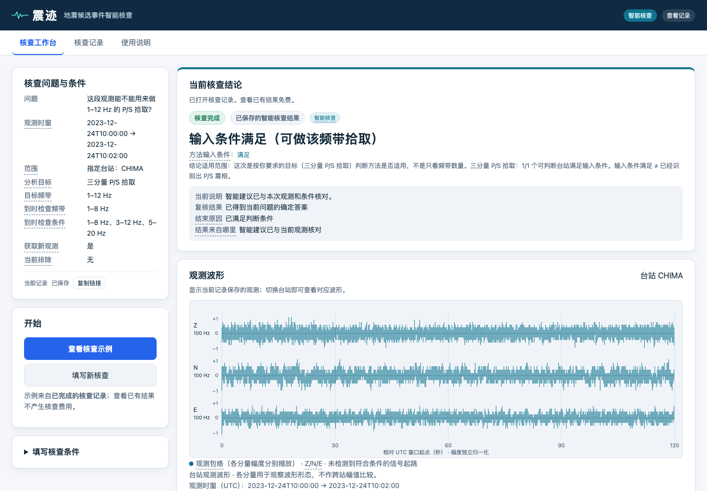

# 震迹 · 地震候选事件智能核查

围绕观测证据开展智能核查，改变条件后继续复核。



震迹根据你提出的问题、UTC 时窗、台站或区域和目标频带，检查方法输入条件、到时诊断与观测证据。工作台可以查看结论、保存的波形与实际核查过程；更改条件后，以关联记录比较前后结果。智能核查的取证与分析由 Agnes Harness（AGH）组织，专业计算结果再与条件和证据核对。

## 快速开始：查看已有真实核查

以下命令适用于 macOS/Linux，使用 Python 3.12。先安装 Git 和 Python；源码不附带虚拟环境或已安装依赖。

```sh
git clone https://github.com/BAOXIAOPAI/zhenji-earthquake-validation.git
cd zhenji-earthquake-validation
python3.12 -m venv .venv
.venv/bin/python -m pip install -r requirements.lock.txt
RUNLOG_DIR="$PWD/replay/runlog" EQ_STRICT_OFFLINE=1 .venv/bin/python main/server.py 8791
```

打开 [本地工作台](http://127.0.0.1:8791/)，点击“查看核查示例”。页面默认显示已保存的真实智能核查，查看已有记录不需要模型密钥、不调用模型，也不获取新观测。

- **核查工作台**：查看问题与条件、核查结论、三分量观测波形、实际核查过程，以及证据详情。
- **核查记录**：打开保存的核查；未完成和失败的情况仍保留。
- **使用说明 → 查看复核对比**：直接打开已有条件复核，对照“上一次核查 → 本次调整 → 本次复核”。

启动命令将记录目录指向仓库中的 `replay/runlog/`。`EQ_STRICT_OFFLINE=1` 禁止联网补齐新观测；它本身不等于禁用模型执行。上述回放只查看已有记录，请勿为查看示例提交“开始智能核查”或条件复核操作。端口占用时，可以把末尾的 `8791` 改为 `8792`，并打开相应地址。

**验证范围：**提交包已通过独立解压与既有依赖环境下的记录回放核验。完整干净依赖安装、AGH 依赖安装与构建尚未复验；上面的安装步骤是启动说明，不代表本轮已完成干净安装验证。详见 [独立回放核验记录](delivery/finalization-2026-10-12/package/独立回放核验-2026-10-14.json) 与 [运行与复现指南](delivery/finalization-2026-10-12/documents/运行与复现指南.md)。

## 已保存的首次核查与条件复核

这两条记录来自真实完成的智能核查，查看时是记录回放，不是现场再次调用模型：

| 记录 | 本地查看入口 | 已保存费用估算上限 |
| --- | --- | --- |
| 首次核查 | [查看首次核查](http://127.0.0.1:8791/?view=workbench&run=r-e2e8419bf299785d) | 0.100140 元 |
| 条件复核 | [查看条件复核](http://127.0.0.1:8791/?view=workbench&run=r-3ae9c6948c2f8967) | 0.081032 元 |

两次已发生核查的记录费用估算上限合计 **0.181172 元**；查看不会重复计费，也不能由这些历史金额推算你的当前余额。

示例指定 UW.CHIMA、三分量 P/S 拾取和 1–12 Hz 目标频带。条件复核把到时检查频带收窄为 3–12 Hz，目标频带仍为 1–12 Hz，并沿用已保存的波形。首次诊断只有 1/13 组有效，复核只有 1/5 组有效，两者均保留“有效检查组合不足（未判断）”，没有将方法输入条件满足包装为到时稳定。

## 结果的科学边界

1. 方法输入条件满足，不等于已经识别 P/S，也不等于确认存在地震。
2. 到时稳定性只描述已检查频带与方法下的结果；检查组合不足时保留未判断，不据此宣称总体准确率或模型优于规则。
3. 波形显示按分量独立缩放，用于观察形态，不能作跨站真实幅度比较；本工具不测定震级、不做定位、不做预警。

## 可选的新核查

新智能核查及智能条件复核会产生费用，需要另行配置本地模型凭据、费用设置与记录、AGH 依赖和本地构建。凭据、真实费用台账及安装产物不在仓库内。标准核查不调用模型，但可能获取公开观测。完整干净安装、AGH 构建以及独立环境中的新收费执行尚未验证，请按 [运行与复现指南](delivery/finalization-2026-10-12/documents/运行与复现指南.md) 核对配置和费用后再选择执行。

## 源码与说明

- [页面源码](main/static/index.html)、[前端交互](main/static/app.js)、[本地服务](main/server.py)、[专业计算](main/core.py)。
- [项目说明](delivery/finalization-2026-10-12/documents/项目说明.md)、[运行与复现指南](delivery/finalization-2026-10-12/documents/运行与复现指南.md)。
- [真实执行与验证证据索引](delivery/finalization-2026-10-12/documents/AGH运行与验证证据索引.md)、[模型与第三方来源](delivery/finalization-2026-10-12/documents/模型与第三方来源清单.md)。
- [精选回放记录](replay/runlog/)、[AGH 源码](vendor/agnes-harness/)、[前端回归检查](main/test_frontend.mjs)。
- [提交材料及链接状态](delivery/finalization-2026-10-12/documents/提交字段与链接清单.md)、[仓库来源与原提交包清单说明](REPOSITORY_SOURCE.md)。

## 来源与许可证

本仓库由已经核验的精选提交包整理，不包含研发目录全历史或安装产物。源码与原 ZIP 的差异范围见 [仓库来源说明](REPOSITORY_SOURCE.md)。根项目尚未指定统一许可证；第三方组件保留其原始许可证与声明，例如 [Agnes Harness 的 Apache-2.0 许可证](vendor/agnes-harness/LICENSE)。
