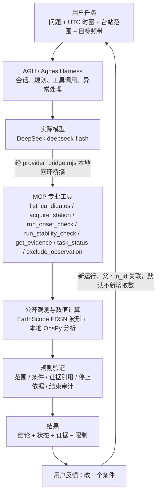

# 项目说明

## 项目名称与副标题

**震迹——基于Agnes Harness的地震候选事件智能核查Agent**

| 参赛信息 | 内容 |
| --- | --- |
| 参赛组别 | 本科生组 |
| 参赛编号 | U105 |
| 队伍名称 | 包小派派派 |
| 队长与成员 | 王新宇（队长及唯一成员，共 1 人） |
| 学校 | 苏州大学 |
| 专业 | 软件工程 |

主介绍语：**让 AI 主动取证、调用专业分析工具，并在你改变条件后继续复核。**

## 摘要

震迹把地震观测的取证、专业数值分析与条件复核组织成一条可交互、可追溯的工作流。用户只需要用自然语言提出一个具体的可判定问题（例如“这段观测能不能用来做 1–12 Hz 的 P/S 拾取？”），系统便在指定的 UTC 时窗与台站范围内，由 AGH（Agnes Harness）承担核心的组织、执行与工具调用，驱动模型选用业务工具，真实取得公开观测、运行本地专业计算，再由确定性验证器检查模型交付是否与证据、范围、停止依据一致。

本作品不是地震预警或上线监测系统，也**不以“总体准确率”或“Agent 优于规则”作为成果主张**。它证明的是一件可核验的事：在已声明范围内，“观测取证—专业工具执行—规则验证—条件变更后复核”这条链路可以真实运行，并能如实区分“输入条件满足”“自动到时证据不足”“正确未知”“被拒交付”“执行失败”这几种不同状态。

**模型说明（如实填写）**：当前真实链使用的演示模型为 DeepSeek 的 **`deepseek-flash`**（提供方 DeepSeek），经由 `main/provider_bridge.mjs` 的本地回环桥接调用；AGH 承担核心组织、执行与工具调用。本作品**没有调用 Agnes 模型**，AGH 是被使用的 Harness 框架（Agnes Harness），不是被调用的模型。

## 问题与用户

用户是希望判断“某段地震波形能不能用于某类分析、以及自动到时是否可信”的研究或工程人员。难点在于：一段波形是否可用，取决于通道健康、三分量是否齐全、采样率与目标频带是否匹配；一次自动到时也可能随算法与参数变化而改变。这些其实是**两个不同的问题**，必须分开回答：

- **输入适用性（method applicability）**：通道是否健康、三分量是否对齐、采样率是否覆盖目标频带。它由输入条件判定。
- **到时诊断稳定性（diagnostic stability）**：在不同算法配置与频带网格上，自动到时是否可复现。它由诊断计算判定。

现有工具往往把两者混为一谈，或把一次漂亮的到时当成“可分析”的证明。震迹把问题拆开，并把每一步的依据、参数、来源与哈希保留下来，供人逐条核对。

## 三项亮点

1. **主动取证与专业工具执行。** 由 AGH 组织真实行动：模型自主选择调用 `list_candidates`、`acquire_station`、`run_onset_check`、`run_stability_check` 等业务工具，真实取得公开观测并运行本地专业计算；结果是在工具实际执行之后才形成的。专业算法负责数值计算，验证器负责检查当前交付，分工明确。
2. **条件变更后继续复核。** 用户可以在同一界面上修改条件（排除/恢复台站、切换方法目标、收紧诊断网格），系统生成一条带父 `run_id` 的新运行，复用父轮已取得的观测但不新增取数，并实际重算受影响的部分。结论不一定会改变，但证据确实会更新——“输入条件满足”与“自动到时证据不足”可以同时成立。
3. **依据可追溯、错误能被拦截。** 当前字段、参与范围、实际参数、证据引用与停止依据都可查；正确未知、被验证器拒绝的模型交付（触发规则后备）、以及执行失败都有各自明确的状态与原因，不把失败改记成成功。

## AGH 流程图



同一条链路的文字版：

```
用户任务 → AGH/实际模型(deepseek-flash) → MCP专业工具 → 公开观测与数值计算 → 规则验证 → 结果
                                                                                 ↑
                                                        用户反馈（新任务条件）────┘
```

## 专业工具清单

工具定义以 `main/tools.json` 为唯一事实来源；`main/provider_bridge.mjs`（白名单/计费）、`main/permission.mjs`（权限授予）与 `main/mcp_server.py` 都读取该文件。

| 工具 | 用途 |
| --- | --- |
| `list_candidates(limit)` | 列出当前范围内可用的候选台站，免费、不发外部请求。 |
| `acquire_station(candidate_id)` | 取得指定候选的真实观测（波形与元数据），受范围、取数许可与候选上限三层守卫。 |
| `run_onset_check(candidate_id)` | 在方法频带上执行自动到时计算，返回值可能为空（无到时）。 |
| `run_stability_check(candidate_id)` | 按当前诊断网格重算到时，并判断多个配置之间是否可复现。 |
| `get_evidence()` | 读取本轮已落盘的证据与当前状态，用于核对，不重新计算。 |
| `task_status(stage)` | 查询当前是否具备结束条件（`progress` / `finish`），返回 `can_finish`。 |
| `exclude_observation(candidate_id, reason)` | 将某个观测排除出当前结论，用于边界与正确未知场景。 |

## 实际成果（真实运行记录）

以下数值直接取自 `main/runlog/` 的原始记录，对应本轮已接收的真实父子链。该链通过产品主服务的 `/api/review` 与 `/api/followup` 执行，模型为 `deepseek-flash`，两轮均 `accepted=true`、`fallback_used=false`（无规则后备）。

| 项目 | 首轮 | 条件反馈 |
| --- | --- | --- |
| run_id | `r-e2e8419bf299785d` | `r-3ae9c6948c2f8967`（父 run：`r-e2e8419bf299785d`） |
| 问题 | 这段观测能不能用来做 1–12 Hz 的 P/S 拾取？ | 同一问题，把到时诊断网格收紧到 3–12 Hz，不要新增取数 |
| 时窗 / 台站 | 2023-12-24T10:00:00–10:02:00 UTC / UW.CHIMA（候选 `409dfad13970`） | 同一时窗与台站 |
| 实际取得 | 1 站，通道 ENE/ENN/ENZ，100 Hz（Nyquist 50 Hz，要求 ≥24 Hz），0 gap | 复用父轮波形，无新增取数 |
| 诊断网格 | [[1,8],[3,12],[5,20]] Hz，13 个配置 | [[3,12]] Hz |
| 工具调用 | `acquire_station` / `run_onset_check` / `run_stability_check` / `get_evidence` / `task_status`，共 7 次 | `run_stability_check` / `get_evidence` / `task_status`，共 5 次 |
| 取数计数 | `logical_acquisitions=1`，`http_attempts=0`，`cache_hits=2` | `logical_acquisitions=0`，`http_attempts=0`，`cache_hits=0` |
| 交付结论 | `pick_applicable`（输入条件满足），`origin=agent_validated` | 同上，`inherited_from_parent=true` |
| 费用上界 | 0.100140 元（7 条计费条目） | 0.081032 元（5 条计费条目） |
| 终态 | `succeeded`，cleanup 正常，`stop_confirmed=true`、`root_removed=true` | 同左 |

**输入适用性（这是“能不能用”）**：验证器结论为“三分量 P/S 拾取：1/1 个可判断台站满足输入条件”，依据是 3 个健康分量、无完整性标记、0 gap，以及 100 Hz 采样完整覆盖 1–12 Hz。输入条件满足 ≠ 已经识别出 P/S 震相。

**到时诊断稳定性（这是“自动到时可不可信”）**：与上面是**两个不同字段**。首轮声明网格 [[1,8],[3,12],[5,20]] 共 13 个配置，仅 1 个有效配置给出到时（12 个 stalta_z 配置无到时，1 个 ar_aic_3c 在 1–20 Hz 给出约 2.53 s），因此 `stability=insufficient_configurations`；反馈轮 3–12 Hz 网格下 4 个 stalta_z 配置无到时、1 个 ar_aic_3c 仍给出约 2.53 s，`n_valid=1` 仍少于 3。两轮 `spread_s` 均为 0.0，但**不能**因 spread=0 就宣称“稳定”——有效配置不足 3 个时系统明确不给稳定性结论。

条件反馈体现的实际重算：父轮与子轮使用**同一波形来源**（同候选、同 SHA-256），子轮不新增取数，但按用户收紧后的网格重新执行了稳定性工具；子轮证据引用为 quality/applicability/stability，未重算 onset。

## 验证与边界

| 场景 | 事实与来源 |
| --- | --- |
| 正常有效交付 | 上述真实父子链，两轮 `accepted=true`、`fallback_used=false`、`cleanup` 正常（`main/runlog/` 原始记录）。 |
| 合法未知 | 排除范围内唯一参与站后，验证器接受“正确未知”：`outcome=legal_unknown`、`can_finish=true`、停止依据 `scope_exhausted`（`delivery/remediation-2026-10-12/evidence/A_B_C_probe_rerun.json` 的 `positive_unique_excluded_legal_unknown`）。 |
| 规则后备 | 三次真实反馈尝试（`r-2365883191ac74a8`、`r-8f2eb7e2a2e7333f`、`r-8c01734ee9f1903a`）实际执行了请求的网格工具、未新增取数，但模型把“诊断网格不稳定”误当作方法适用性结论而被验证器拒绝：`model_claim_accepted=false`、`origin=fallback`、`fallback_used=true`，保留原主张与拒绝原因。这些失败记录未被删除。 |
| 受控失败 | 受控超时场景返回 `status=failed`、`failure_kind=timeout`，同时资源被完整回收（`delivery/remediation-2026-10-12/evidence/agh_resource_integration.json` 的 `timeout` 场景）。失败不会被历史结果顶替。 |
| 提前停止被拦截 | 请求范围内仍有可取候选却提交空范围与 `scope_exhausted` 的反例被拒绝：`accepted=false`、`outcome=strategy_insufficient`、`can_finish=false`、`remaining_acquirable` 列出该候选（同上 JSON 的 `unstarted_explicit_scope_unknown`）。 |

**能力边界**：当前结果证明的是已声明范围内的观测输入、到时诊断与条件反馈流程可运行、可追溯，并能区分正常、未知、后备与失败。它不证明某时窗内一定存在事件，也不证明人工 P/S 拾取可靠；单站范围不给出台网级或传播结论。历史实验中已撤销的总体完成率、Agent 基线优势、误报率与人工时间等数字，本说明不恢复、不引用。

## 后续愿景

在保持“证据可追溯、错误可拦截”的前提下，可以把候选事件复核扩展到更多台站与更广的候选集合，并在同一条件—证据模型下接入更多专业工具（响应谱、震级估计、多台定位等）。扩展方向是自动化复核的覆盖面与效率，而不是用一次演示结果替代统计意义上的能力证明。

## 相关文档

- 产品入口与快速使用：[README](./README.md)
- 环境与复现：[运行与复现指南](./运行与复现指南.md)
- 证据索引：[AGH运行与验证证据索引](./AGH运行与验证证据索引.md)
- 模型与第三方来源：[模型与第三方来源清单](./模型与第三方来源清单.md)
- 提交字段对照：[提交字段与链接清单](./提交字段与链接清单.md)
