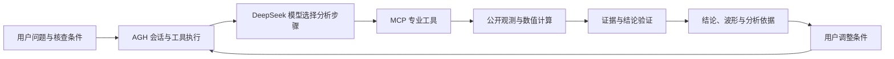

# 震迹

**基于 Agnes Harness 的地震候选事件智能核查 Agent**

震迹将公开观测获取、地震波形分析、结论验证和条件变更复核组织为一条可交互的核查流程。用户提出问题，指定 UTC 时窗、台站与目标频带；系统取得观测并执行专业计算，展示结论、波形、分析过程和证据来源。

## 问题与目标

判断一段波形能否用于分析，需要同时检查通道完整性、三分量对齐、采样率和目标频带。自动计算出的到时还需要在多个算法配置下检验一致性。震迹分别回答两个问题：

| 核查内容 | 判定依据 | 结果含义 |
| --- | --- | --- |
| 输入适用性 | 通道健康、分量完整性、采样率和频带 | 当前观测是否满足所选方法的输入条件 |
| 到时诊断稳定性 | 多个算法配置与频带下的自动到时 | 现有自动到时证据是否足以支持稳定性判断 |

研究人员可以检查每一步的观测、计算条件和证据引用，并通过修改条件继续复核。

## 核心流程

AGH 承担会话组织、连续执行和工具调用；DeepSeek 模型选择工具并提出结论；ObsPy 等数值组件执行波形分析；验证器核对结论的条件、范围、证据引用和结束依据。

| 工具 | 职责 |
| --- | --- |
| `list_candidates` | 列出当前台站范围内的候选观测 |
| `acquire_station` | 获取指定候选的波形和台站元数据 |
| `run_onset_check` | 计算方法频带下的自动到时 |
| `run_stability_check` | 在诊断网格上计算多配置到时及其一致性 |
| `get_evidence` | 读取本次核查的观测与计算证据 |
| `task_status` | 检查当前是否具有充分的结束依据 |
| `exclude_observation` | 将不参与本次判断的观测移出结论范围 |

工具定义见 `main/tools.json`。

## 交互方式

“核查工作台”显示任务条件、当前结论、保存的真实三分量波形及分析依据；“核查记录”保留每次核查及条件反馈的关联；“使用说明”解释方法和操作步骤。

填写条件后可直接开始，系统自动检查输入。“确认条件（免费）”可用于提前查看条件。智能核查调用模型；标准核查使用预设方法。查看已有记录只读取保存的材料。

用户调整台站、方法目标或诊断频带后，系统创建关联上一条记录的新核查。默认复用已有观测，并重新计算受影响的分析项，便于比较条件与结果。

## 观测结果与适用范围

保存的真实示例使用 UW.CHIMA 台站的 2023-12-24T10:00:00–10:02:00 UTC 观测，包含 ENE、ENN、ENZ 三个 100 Hz 分量。首轮及条件反馈均形成通过验证的输入适用性结论。诊断计算仅有一个有效到时配置，因此结果为“有效配置不足”，不据此给出稳定到时结论。

本作品提供指定观测范围内的输入条件检查、到时诊断和条件反馈复核。单站结果限定于该站观测；输入条件满足不等于识别出地震事件或人工 P/S 震相。现有样例用于验证流程与结论的一致性，不能推导总体准确率、误报率或台网级结论。

真实核查记录位于 `replay/runlog/`；正常、边界和失败样例的结果与来源见[验证结果](./验证结果.md)。

## 文档

- [运行指南](./运行指南.md)
- [模型与数据来源](./模型与数据来源.md)
- [验证结果](./验证结果.md)
- [参赛信息](./参赛信息.md)
- [独立完成说明](./独立完成说明.md)
